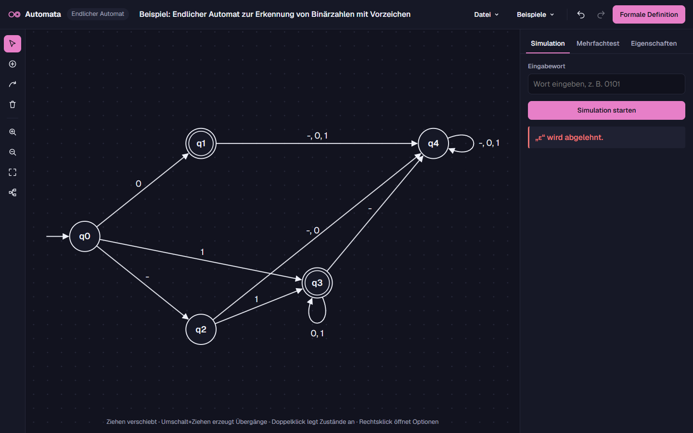

# Automata

A modern, browser-based workbench for formal languages and automata theory, inspired by [JFLAP](https://www.jflap.org).
Built with [Astro](https://astro.build), [Svelte](https://svelte.dev) and TypeScript. The user interface is in German.



## Features

- **Finite automata** (NFA/DFA, ε-transitions, multi-character symbols): graph editor with automatic layout, step-by-step
  simulation and batch tests, analysis, trap state completion, NFA → DFA, minimization, conversion to regular expression
  and right-linear grammar, formal definition export (text, Markdown, LaTeX, SVG, PNG, PDF), JSON and JFLAP `.jff`
  import/export.
- **Regular expressions**: batch tests and conversion to an ε-NFA (Thompson construction).
- **Grammars**: Chomsky classification, Chomsky normal form, CYK, FIRST/FOLLOW sets, LL(1) parsing with derivation tree
  and regular grammar → NFA.

Planned: SLR(1) and brute-force parsing, pushdown automata, Turing machines and L-systems.

### Keyboard shortcuts (automaton editor)

| Key                 | Action                                    |
|---------------------|-------------------------------------------|
| `V` `Z` `U` `L`     | Select, state, transition and delete tool |
| `Del` / `Backspace` | Delete selection                          |
| `F2`                | Rename selected state                     |
| `F` / `A`           | Fit view / arrange automatically          |
| `Ctrl+Z` / `Ctrl+Y` | Undo / redo                               |
| `Ctrl+S` / `Ctrl+O` | Save / open                               |

In the select tool, `Shift`-drag creates a transition and `Alt`-drag disables grid snapping.

## Development

```sh
npm install
npm run dev      # local dev server
npm test         # unit tests
npm run build    # type-check and build into dist/
```

## AI notice

Large parts of this project were written with the help of AI ([Claude Code](https://claude.com/claude-code)).
All changes are reviewed and tested before they are published.
